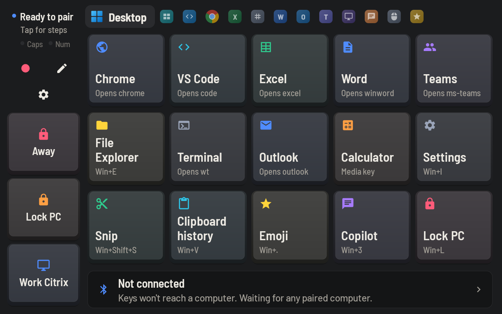

# Macropad for Android

Turns a spare Android tablet into a wireless **touch macropad and trackpad** for your computer.
The tablet pairs over Bluetooth Low Energy as a standard **BLE keyboard + mouse (HID over GATT)**,
so nothing has to be installed on the computer — Windows, macOS, Linux, ChromeOS, iOS and Android
all support it natively. Everything runs on the tablet.

Built and tested on an **Amazon Fire HD 8 (8th gen, KFKAWI, Fire OS 7.3 / Android 9)** paired with
Windows laptops/desktops.



## Features

- **Pages (tabs)** with ready-made shortcuts: **Desktop** (open apps, snip, clipboard history, emoji,
  Copilot, lock), **Monitors** (snap and move windows between screens, virtual desktops, *Away*),
  **VS Code**, **Chrome**, **Excel**, **Numpad**, **Word**, **Outlook**, **Teams**, **Citrix**,
  **Phrases** (ready-to-type replies, date, signature), a **Trackpad**, and an empty **Custom** page.
  Teams and Outlook keys work even while a Citrix / Remote Desktop window has focus — see
  [docs/citrix.md](docs/citrix.md).
- **Sidebar** on every page: status, Record, Edit, Settings, ⇄, and action keys (Away, Lock PC, Work
  Citrix — a login filled in from encrypted **saved values**, see ⚙ → Saved values).
- **App icons on the tabs** (long-press a tab to rename it or change its icon).
- **Dock** on every page: media keys as icons (Previous · Play/Pause · Next), a volume slider and Mute,
  and virtual-desktop switching (Prev desktop · Task view · Next desktop).
- **Trackpad page**: pointer with acceleration, tap / two-finger tap to click / right-click,
  two-finger or edge-strip scrolling, long-press to drag, plus editable click/scroll keys.
- **Sliders**: drag a key instead of tapping it for PC volume, scrolling, zoom, brightness,
  switching tabs or undo/redo, one step per tick (`slide:volume`, or any pair of keys).
- **Toggle keys** (Teams mute, camera, hand, blur) show their ON/OFF state; any key can also have a
  **long-press action** (e.g. tap = toggle mute, hold = push to talk).
- **PC link** (Classic Bluetooth tablets, e.g. Galaxy Tab S5e): a Bluetooth serial port next to the
  keyboard and a PowerShell script on the computer. Teams keys light up from Teams' real state and
  work without focusing Teams, pages follow the app in front, the idle clock shows the next Outlook
  meeting, and `pc:run` keys start commands you list. See [docs/pc-link.md](docs/pc-link.md).
- **Text variables** in typed text: `{date}`, `{time}`, custom date formats and `{clipboard}`.
- `page:` actions to change page from a key or the tablet's volume buttons.
- **Idle clock**: dims to a clock when not used; the waking touch never presses a key. The
  **Away** key locks the PC and dims the tablet (hold: also mutes the Teams call).
- **PIN lock** for editing and settings.
- **Tablet volume buttons** act as macropad keys (PC volume by default; assignable to any action).
- **Edit mode** (✏️): tap any key to change its label, action, accent color, icon (96 icons) and
  toggle behaviour.
- **Macro language**: key combos, media keys, typed text, delays, mouse clicks and scrolling —
  see [docs/macro-language.md](docs/macro-language.md).
- **Recorder** (●): press keys, type text or send combos — each is sent to the computer live and
  captured with its timing — then save it as a new key on the Custom page.
- **Keyboard layouts** for typed text: English (US), English (US International), Spanish (Latin
  America), Spanish (Spain).
- **Several computers**: remembers every computer it has served; switch between them with one tap
  (⇄). Each computer can have its own name, keyboard layout, key timing (e.g. slower for Citrix),
  pages and start page.
- **Runs in the background** as a foreground service, so the connection survives the screen being
  closed or recreated. Can start on boot and come to the front when the charger is plugged in.
- **Backup**: layout auto-saved to a JSON file, plus export/import through the file picker.
- **Diagnostics** screen: connection health checks and recent Bluetooth events, no adb needed.

## Requirements

| | |
|---|---|
| Tablet | Android 9 (API 28) or newer with BLE **peripheral/advertising** support, or the Classic HID Device profile (Samsung). Tested: Fire HD 8 (8th gen); Galaxy Tab S5e set-up in [docs/devices.md](docs/devices.md) |
| Build machine | JDK 17, Android SDK (platform 34, build-tools 34). Gradle comes via the wrapper. |
| Computer | Any OS with Bluetooth LE |

> Many tablets — including Fire tablets — ship with the *Classic* Bluetooth HID-device profile
> disabled (`profile_supported_hid_device=false`), which is why this app implements BLE HID over
> GATT itself. Where the profile exists (Samsung), ⚙ → Connection → Bluetooth: *Automatic* uses
> Android's `BluetoothHidDevice` instead, and the tablet reconnects to the computer by itself.
> See [docs/devices.md](docs/devices.md) for what differs between tablets.

## Install

Either download an APK from the [Releases](../../releases) page / the **Actions** tab (debug APK
artifact), or build it:

```bash
export JAVA_HOME=/path/to/jdk-17
export ANDROID_HOME=/path/to/Android/Sdk      # or put sdk.dir in local.properties
./gradlew assembleDebug
# → app/build/outputs/apk/debug/app-debug.apk
```

Then, with **USB debugging** enabled on the tablet:

```bash
adb install -r app/build/outputs/apk/debug/app-debug.apk

# One time: lets the app keep Fire OS from treating the PC as headphones and from accepting
# Classic Bluetooth connections — both make Windows drop the keyboard.
adb shell pm grant dev.belta.macropad android.permission.WRITE_SECURE_SETTINGS

# Recommended for a dedicated macropad: stay awake while charging.
adb shell settings put global stay_on_while_plugged_in 7
```

On Linux, adb may need a udev rule for the tablet's USB vendor ID (Amazon is `1949`):

```bash
echo 'SUBSYSTEM=="usb", ATTR{idVendor}=="1949", MODE="0666", GROUP="plugdev"' \
  | sudo tee /etc/udev/rules.d/51-android.rules
sudo udevadm control --reload-rules && sudo udevadm trigger
```

Use a charger of at least 2 A — with the screen always on, a weak USB port can't keep up.

> Debug and release builds are signed with different keys. Switching between them requires
> uninstalling first, which clears the app's data — **export your layout first** and re-run the
> `pm grant` command afterwards.

## Pair with a computer

1. Open **Macropad** on the tablet; the status at the top of the sidebar shows **Ready to pair**.
2. On the computer, add a Bluetooth device and choose **Fire Macropad**
   (Windows: *Settings → Bluetooth & devices → Add device → Bluetooth*).
3. **Confirm the 6-digit code on both screens.** The tablet shows the code and opens its
   notification shade — tap **Pair** there.
4. Windows connects, disconnects and reconnects within a few seconds (normal for BLE keyboards).
   The chip turns **green** with the computer's name.

The computer reconnects automatically while the macropad runs, also after the tablet was out of
range, the computer slept, the app was updated or the tablet's Bluetooth restarted. One computer is connected at a time:
tap **⇄** to hand the macropad to the other one, or pick in ⚙ → **Computers…**, where each computer
can also be renamed and given its own layout, key timing, pages and start page. **Avoid opening Bluetooth settings on the tablet** — its scan
re-learns the PC as a Classic device. If connections drop, open ⚙ → **Diagnostics…**, and if needed
**Reset pairing**, then remove and re-add *Fire Macropad* on the computer.
See [docs/bluetooth-troubleshooting.md](docs/bluetooth-troubleshooting.md).

> Updating from 1.0: the keyboard description changed (mouse added). Remove and re-add
> *Fire Macropad* on each computer once so it picks up the trackpad.

## Using it

| Control | What it does |
|---|---|
| Tabs | Switch page. Long-press a tab to rename it. |
| ⇄ | Switch to the other computer (shown once two are paired). |
| Status | Connection state, plus the computer's Caps and Num Lock (lit while on); tap for details, switching computer and diagnostics. |
| ● / ■ | Start / stop recording a macro. |
| ✏️ / ✓ | Edit mode: tap a key to edit, tap an empty slot to add one. |
| ⚙ | Settings (below). |
| Tablet volume buttons | Assigned actions (default: PC volume). Clear an assignment to give the button back to the tablet. |
| Notification | Shows the connection; **Quit** stops the macropad completely. |

**Settings (⚙):** reset ON/OFF keys · grid size · default keyboard layout · default key timing ·
computers (name, layout, timing, pages, start page) · tablet volume buttons · dim when idle · PIN lock ·
pages (add keys/trackpad page, rename, reorder, delete) · backup and restore · startup (open on
boot / when charging) · diagnostics · quit.

Shortcuts on the app pages are the **Windows** defaults; on macOS, edit keys to use `cmd`.

## Backup

- Every change is written to `/sdcard/Android/data/dev.belta.macropad/files/macropad-layout.json`:
  ```bash
  adb pull /sdcard/Android/data/dev.belta.macropad/files/macropad-layout.json backup/
  ```
- ⚙ → **Backup and restore** exports/imports the same JSON through the file picker.
- [backup/macropad-layout.json](backup/macropad-layout.json) in this repo is the current layout.

## Development

```
app/src/main/java/dev/belta/macropad/
  MainActivity.kt      Screen: tabs, key grid / trackpad, dock, key presses, volume buttons
  MacropadService.kt   Foreground service that owns the Bluetooth keyboard
  BootReceiver.kt      Start on boot
  hid/                 HidPeripheral (GATT server, advertising, sending, Fire OS workarounds),
                       HidReports (report descriptor + builders), HidKeys, KeyboardLayout
  model/               Macro (parser), Layout + LayoutJson, DefaultLayout, MacroStore, AppSettings
  ui/                  KeyViews, KeyCap (keycap drawing), KeyEditor, Recorder, TrackpadView, SliderView,
                       Dialogs, MenuDialog (menu rows), Ui (theme), Icons, AppIcons
app/src/test/          Unit tests (macro parser, keyboard layouts, HID reports, layout JSON)
tools/gen_icons.py     Regenerates res/drawable/ic_k_*.xml and ui/Icons.kt
```

```bash
./gradlew testDebugUnitTest      # unit tests
./gradlew assembleRelease        # signed with keystore.properties (see below), else the debug key
adb logcat -s HidPeripheral      # Bluetooth events (GATT request details in debug builds)
```

**Release signing.** Create a keystore outside the repo and a git-ignored `keystore.properties`:

```properties
storeFile=/home/you/.android/macropad-release.jks
storePassword=…
keyAlias=macropad
keyPassword=…
```

Keep the keystore and its password backed up — updates must be signed with the same key.

**CI.** [.github/workflows/android.yml](.github/workflows/android.yml) runs the tests and uploads a
debug APK on every push. Pushing a tag `v*` also builds the release APK and attaches it to a GitHub
Release. To sign it, add repository secrets `MACROPAD_KEYSTORE_BASE64` (`base64 -w0 your.jks`),
`MACROPAD_KEYSTORE_PASSWORD`, `MACROPAD_KEY_ALIAS` and `MACROPAD_KEY_PASSWORD`.

See [CHANGELOG.md](CHANGELOG.md) for what changed between versions.

## Credits and licenses

- [Barlow](https://github.com/jpt/barlow) and Barlow Semi Condensed fonts — SIL Open Font License 1.1 ([licenses/Barlow-OFL.txt](licenses/Barlow-OFL.txt)).
- Most key icons use path data from Google's [Material Icons](https://fonts.google.com/icons) — Apache License 2.0.
